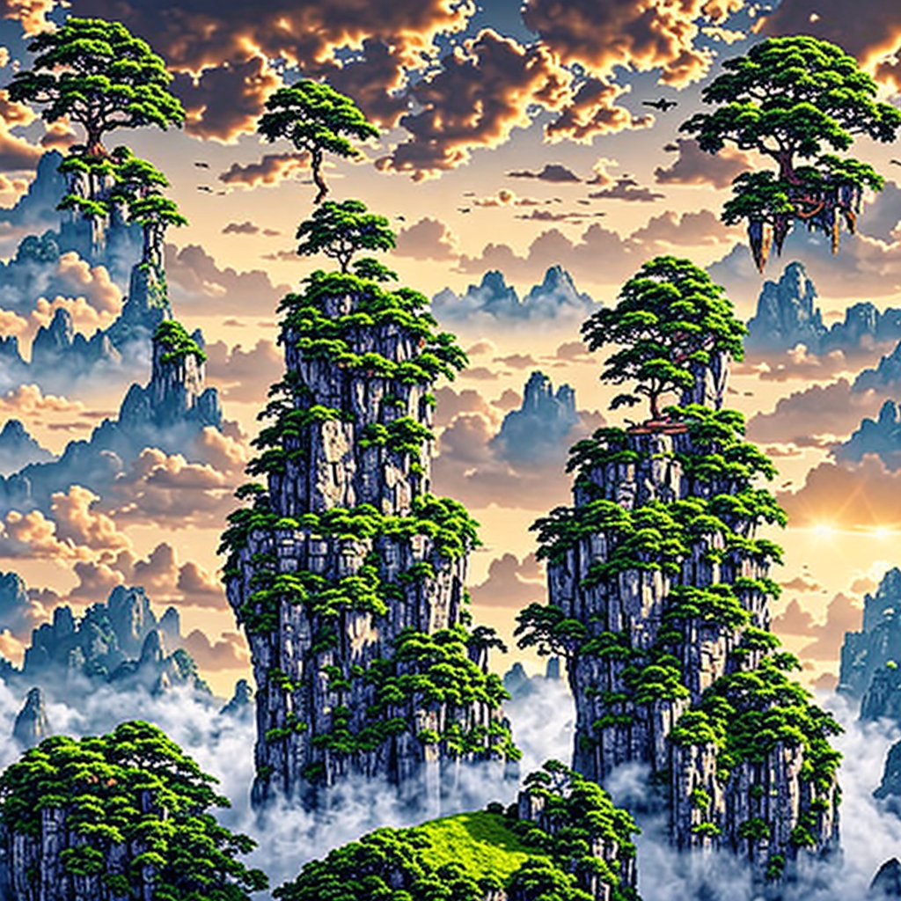
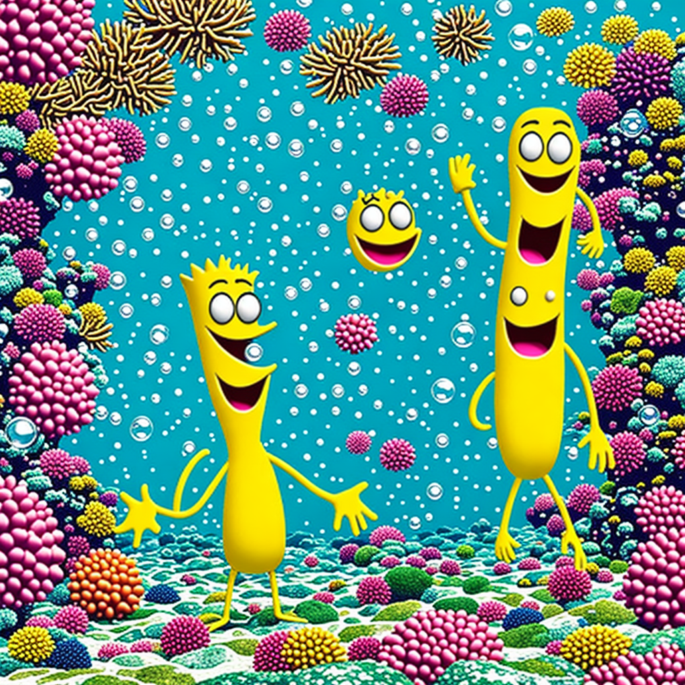

# Generador de Imágenes

Generador de imágenes a partir de texto (*text-to-image*) usando el modelo [`stabilityai/sd-turbo`](https://huggingface.co/stabilityai/sd-turbo) con la librería `diffusers` de Hugging Face. El programa se ejecuta en CPU.

## Requisitos

- Python 3.12 o superior
- [uv](https://docs.astral.sh/uv/)

Dependencias principales: `torch`, `diffusers`, `transformers` y `accelerate`.

## Instalación y uso

```bash
uv sync
uv run generadorimagenes
```

El programa pide un prompt por consola, genera la imagen y la guarda en el directorio actual.

### Parámetros usados

| Parámetro             | Valor        | Descripción                                   |
|-----------------------|--------------|-----------------------------------------------|
| `num_inference_steps` | 10           | Veces que el modelo crea y corrige la imagen  |
| `guidance_scale`      | 2.0          | Qué tan fiel es la imagen al prompt           |
| `height` x `width`    | 1024 x 1024  | Resolución de la imagen                       |
| `torch_dtype`         | `float32`    | Precisión (cambiar a `float16` si sale negra) |

**Negative prompt:**

```text
low quality, blurry, distorted, text, watermark, extra fingers, deformed, mutated, poorly drawn, ugly, bad anatomy, oversaturated, grainy, cropped, unrealistic colors
```

## Resultados

### Isla flotante



**Prompt:**

```text
a single floating island centered in the sky above a sea of clouds, one giant ancient tree, green forest, white stone ruins, waterfalls falling into mist, soft golden sunset light, fantasy concept art, detailed, cinematic wide shot
```

### Bob Esponja



**Prompt:**

```text
SpongeBob SquarePants standing on the sandy ocean floor of Bikini Bottom, big smile, cartoon style, bright colors, underwater with bubbles, coral and seaweed in the background, centered, full body
```
